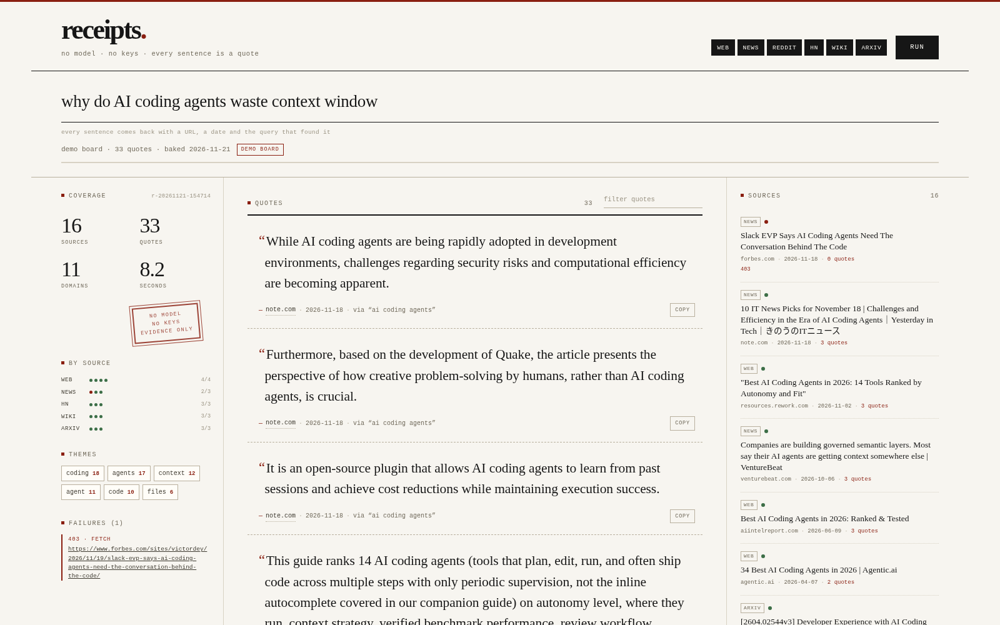

# receipts

**A research desk that cannot hallucinate: quotes with URLs, dates and receipts.**

[Quick start](#quick-start) · [Commands](#commands) · [MCP](#mcp) · [How it works](docs/architecture.md) · [Limits](#limits) · [Changelog](CHANGELOG.md)

[](https://github.com/shattradingle/receipts/actions/workflows/ci.yml)
[](https://github.com/shattradingle/receipts/releases)
[](LICENSE)
[](pyproject.toml)

<sub>Part of the keyless stack — public data for agents, with receipts. No API key anywhere.</sub>

**[Open the live demo](https://shattradingle.github.io/receipts/)** (a real board, no server, no network).

Ask it a question and it searches six free sources, fetches the pages, and hands back a board of sentences that were already written there. There is no model in the loop, so there is nothing to hallucinate. Every quote keeps its source URL, its date and the query that found it.

<sub>Six keyless adapters. 121 tests, all offline. Zero runtime dependencies.</sub>

## Quick start

Python 3.10 or newer. Standard library only, no key, no account.

```console
# no install, straight from git
$ uvx --from git+https://github.com/shattradingle/receipts receipts research "why do AI coding agents waste context window" --sources hn,news --depth 1
receipts · why do AI coding agents waste context window
2026-11-21T15:25:16Z · 20 quotes · 12 pages ok / 0 blocked · 2 queries · 6.1s

THEMES
  agents (8)
  coding (7)
  context (7)
  code (6)
  codex (3)
  terminal (3)

QUOTES
  "A GitHub bot on SelfBench: every pull request that changes your docs gets agents running your tasks with the old docs and with the new ones."
  — github.com · 2026-05-20 · via “why do AI coding agents waste context window”
…

# or a normal install, then the desk
$ git clone https://github.com/shattradingle/receipts && cd receipts
$ python3 -m venv .venv && . .venv/bin/activate && pip install .
$ receipts demo
receipts demo → http://127.0.0.1:8788/
```

The board is also JSON (`--json`), and `--out DIR` writes `board.json`, `board.md` and a self-contained `board.html`.

## See it work

The desk, with a real baked board, no network:

```console
$ receipts demo
receipts demo → http://127.0.0.1:8788/
Ctrl-C to stop.
```

If port 8788 is taken, add `--port 8790`.



The demo board is a real run from 2026-11-21: 33 quotes, 15 pages ok, one blocked page, 15 queries, 8.2 seconds, five source kinds. The blocked Forbes page is in Coverage with its 403. Nothing on that board was written for it. The layout stacks below 900px ([mobile view](docs/screenshots/desk-mobile.png)), and `?theme=dark` or `?theme=light` overrides the system theme.

To make the same kind of static file, with no server at all (take the id from `receipts list`):

```console
$ receipts export <run_id> --html --out board.html
```

## Who this is for

| you are | start here |
| --- | --- |
| you have an agent and want evidence it can read | [MCP](#mcp); two tools, one of them runs a board |
| you want a CLI and a JSON file | [Commands](#commands) and `--json` |
| you want to see it before installing | `receipts demo` or the [screenshot](docs/screenshots/desk-light.png) |

## Commands

| command | what it does |
| --- | --- |
| `receipts serve` | the desk at `http://127.0.0.1:8787` |
| `receipts demo` | a baked board at `http://127.0.0.1:8788`, no network |
| `receipts research "question"` | run the pipeline; `--sources`, `--depth 1\|2\|3`, `--max-pages`, `--json`, `--out DIR` |
| `receipts board <run_id>` | print a stored board; `--json` |
| `receipts list` | recent runs, newest first |
| `receipts export <run_id> --md\|--html --out FILE` | write a board |
| `receipts mcp` | stdio MCP server |
| `receipts --version` | `receipts 1.0.0` |

Exit codes: `0` ok, `1` nothing found, `2` nothing could be fetched, `64` usage.

State lives at `${XDG_STATE_HOME:-~/.local/state}/receipts/receipts.db`, or under `$RECEIPTS_HOME`. `pip install .` is the whole install.

## MCP

Point a client at the stdio server:

```json
{
  "mcpServers": {
    "receipts": {
      "command": "receipts",
      "args": ["mcp"]
    }
  }
}
```

| tool | arguments | returns |
| --- | --- | --- |
| `receipts_research` | `question`, optional `sources`, optional `depth` | the board as JSON, plus a compact text block |
| `receipts_export` | `run_id`, optional `fmt` (`md`, `html`, `json`) | the path of the written file |

Importing the package makes no network request. `receipts mcp` writes JSON-RPC lines to stdout and nothing else.

## How it works

```
expand → search (6 sources) → dedupe → select pages → fetch
       → extract main text → quote 20–45 words → theme → SQLite + board
```

The parts that matter:

- **Verbatim quotes.** Sentences are sliced from the extracted page text. No splicing, no paraphrase. A sentence over 45 words is cut at a word boundary and marked with an ellipsis; a sentence under 20 is skipped.
- **Deterministic board.** For the same fetched pages, same source ids, quote ids, order, scores and themes. No randomness in the pipeline.
- **Failures are output.** A 403, a timeout, a page with no text: each one becomes a status row and a failure entry. A block is never treated as an absence.
- **No model, no key.** Six keyless adapters, `urllib.request`, `html.parser`, `sqlite3`, `http.server`. `tests/test_no_network.py` enforces the host allowlist and the missing dependency list.
- **The desk is three files.** No build step, no CDN, no font request, no image other than the wordmark drawn in CSS.

The full pipeline, source decisions and measured live outcomes are in [docs/architecture.md](docs/architecture.md).

## What is different

| feature | receipts | a deep-research agent | why it matters |
| --- | --- | --- | --- |
| output | quotes with URL, date and query | a written answer | you can check every sentence against its source |
| model | none | an LLM | no key, no bill, no drift between runs |
| failure handling | every block listed with a reason | often a shorter answer | a missing source looks like a missing source |
| speed | 6 to 30 seconds for a board | minutes | useful while narrowing a question |
| synthesis | none, by design | better | it is worse when you want one readable answer |

## Limits

Measured on 2026-11-21 from one Linux machine through a logging proxy. These are the things that break, not a roadmap.

| source | live result on 2026-11-21 (final demo run) | in the demo |
| --- | --- | --- |
| web | Bing answered 200. Every organic link is a `/ck/a?u=a1…` redirect, which the adapter decodes; it produced **4 pages, 11 quotes**. Relevance is still the weakest of the five: the same query on an earlier run gave generic results, and Mojeek returned 403. | yes |
| news | **3 pages (2 ok, 1 blocked), 6 quotes**. The blocked Forbes page is in Coverage with its 403. Google News links are JavaScript redirects, so the Bing News RSS fallback supplies the publisher URLs. | yes |
| hn | **3 pages, 4 quotes**. | yes |
| wiki | **3 pages, 4 quotes**. It drifts on a very specific question (Omarchy, Chemotherapy, GLM). | yes |
| arxiv | **3 abstracts, 8 quotes**. PDFs are not read. | yes |
| reddit | Not in the baked board: a 12-sub fan-out hits the archive's throttle, and the build shell's research rail forbids raw archive calls. The adapter is fixture-tested and best effort. | no |

More limits:

- **No JavaScript rendering.** Pages that need a browser are `thin` or `empty`. That is common with news sites and single-page apps.
- **Web search is the weak source.** The HTML parser is fine; the results from this IP were not. A blocked or useless web source is recorded, not retried forever.
- **Reddit is best effort.** arctic-shift allows a keyword query only when scoped to a subreddit, so one search is 12 scoped requests and some will be blocked. Expect `blocked` rows on a busy day.
- **Quotes are 20 to 45 words.** A page of brilliant six-word sentences contributes nothing. That is the price of a rule you can check.
- **No relevance model.** Page selection ranks by question-term hits and sources round-robin; it does not understand the question. An off-topic page can still be fetched. It is listed as a source, not hidden.
- **The demo is five sources, not six.** It uses `web,news,hn,wiki,arxiv` at depth 2: every source that answered from a normal connection produced at least four quotes. Reddit is the sixth adapter and is not in the baked board, because the archive throttles a 12-sub fan-out; the adapter is fixture-tested and listed as best effort above.
- **Not a synthesis tool.** If you want an answer written for you, this is the wrong tool. It gives you the material to write one.
- **The web changes.** Determinism is over the fetched pages. The same question tomorrow can return a different board.
- **Local state only.** No account, no sync, no cloud. `RECEIPTS_HOME` moves the database and exports.

## Part of the keyless stack

Public data for agents, with receipts. No API key anywhere:

- **[reddit-rail](https://github.com/shattradingle/reddit-rail)** — Reddit research for your agent: search threads and read whole comment trees.
- **[osint-rail](https://github.com/shattradingle/osint-rail)** — one seed in, a sourced dossier out, every claim with its URL.
- **[receipts](https://github.com/shattradingle/receipts)** — a research desk that only quotes what it fetched.

## Changelog

See [CHANGELOG.md](CHANGELOG.md). MIT licence.
